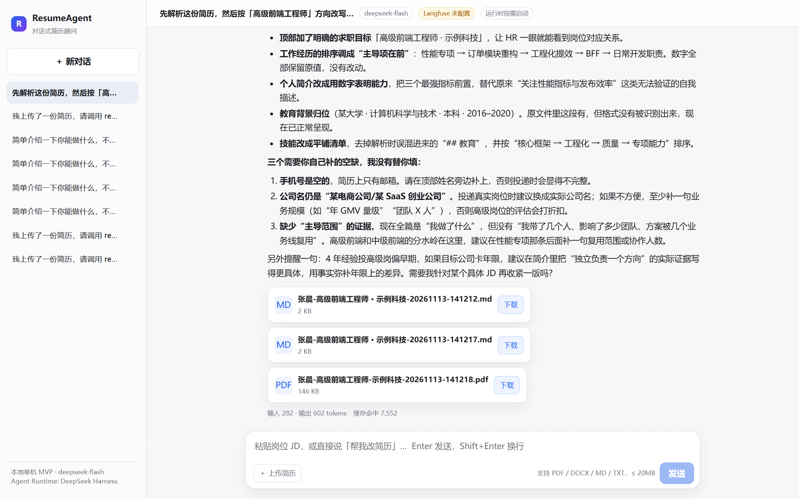
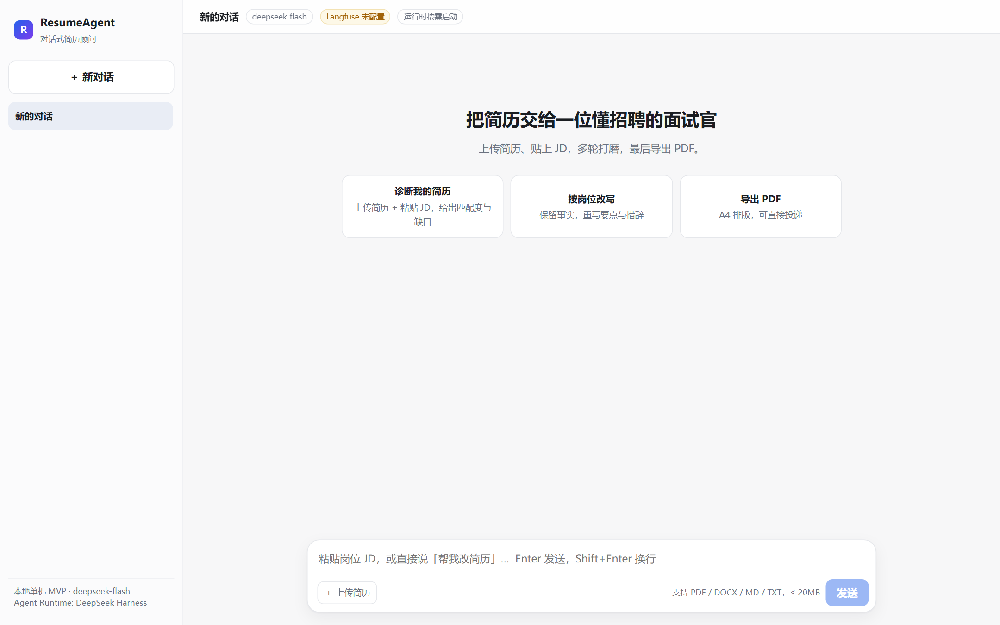
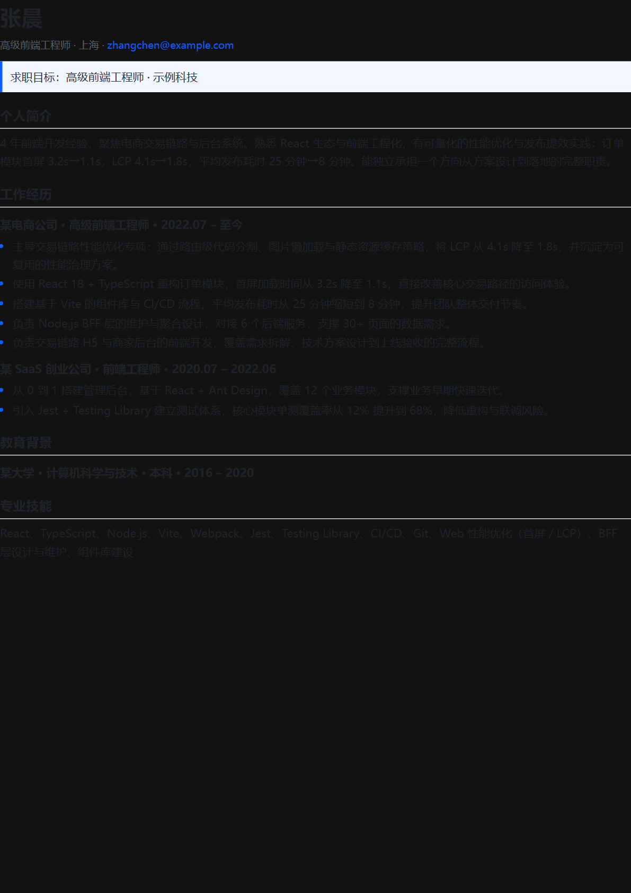
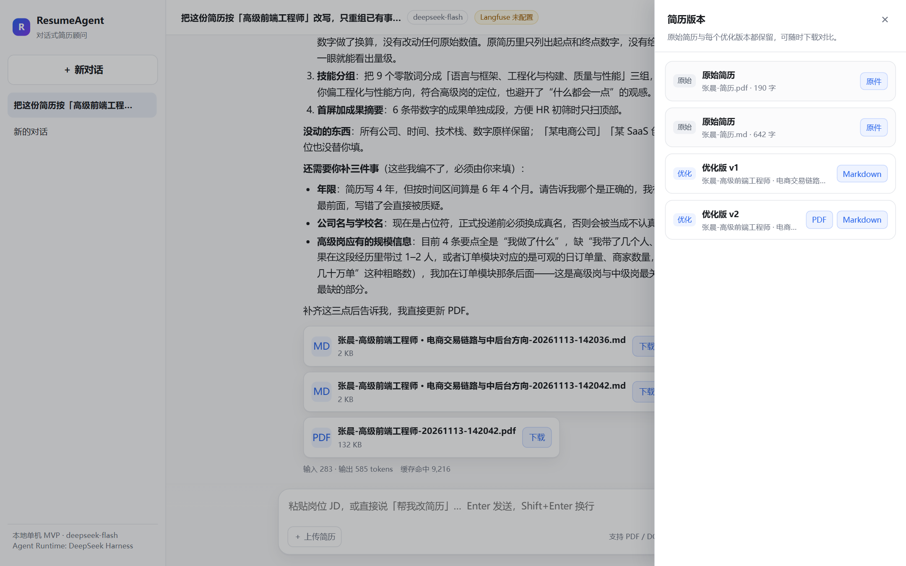

# ResumeAgent

对话式简历 Agent：上传简历、贴上 JD，多轮打磨，最后导出 A4 PDF。

前端是类 ChatGPT 的对话框（多轮、上传、流式回复、产物下载），后端用 TypeScript 驱动 **DeepSeek Harness** 运行时（`deepseek-flash`），简历解析/改写/PDF 生成以 **MCP 工具** 的形式交给 Agent 自主调用，全链路可接入 **Langfuse** 观测。

单用户、单机部署的 Web MVP，不含支付、团队协作与自动投递。



## 源码精读

如果你想从入口开始理解当前实现的每一层，请按顺序阅读 [源码精读手册](docs/code-guide/README.md)。它覆盖共享协议、持久化、SSE、DSH 运行时、MCP 工具、React 状态和验证脚本，并给出完整行号地图。

## 技术 Demo

[Agent 工具调用最小演示](demo/agent-loop.html) 是一个不需要 API Key、可以直接双击打开的单文件网页。它用“假模型、真工具函数”演示 `resume_parse → tool result → resume_rewrite → artifact` 的完整 Agent 闭环。

| 空状态 | 导出的简历 PDF |
|---|---|
|  |  |

## 简历版本

一次会话里同时保留 **原始简历** 和每一个 **优化版**：

- 上传即登记「原始简历」版本，并立刻解析出经历/要点/技能数（扫描件会明确提示暂不支持 OCR）
- 每次 `resume_rewrite` 产出登记为「优化版 v1 / v2 …」
- `pdf_generate` 的 PDF 挂到最近的优化版上
- 点顶栏「简历版本」抽屉可下载任意版本（原件 / Markdown / PDF）



```
浏览器 ──SSE──▶ Express ──JSON-RPC(stdio)──▶ DSH runtime (sdk profile, deepseek-flash)
                   │                              │
                   │                              └──MCP(stdio)──▶ resume_parse / resume_rewrite / pdf_generate
                   └── Langfuse（trace / generation / span / usage / error）
```

## 快速开始

```bash
npm install

# 终端 A：起后端（会自动构建 MCP 工具、启动 DSH 运行时）
npm run dev:server

# 终端 B：起前端（Vite，代理 /api 到 5178）
npm run dev:web
```

打开 http://localhost:5179 （Vite 绑定的是 localhost；用 127.0.0.1 可能连不上）。

生产方式：

```bash
npm run build      # 构建 MCP 工具 + 前端静态资源
npm start          # 单进程在 5178 同时提供 API 与页面
```

## 前提：DSH 运行时

后端通过 [`@deepseek-ai/dsh-sdk-client`](https://www.npmjs.com/package/@deepseek-ai/dsh-sdk-client) 以子进程方式启动 DSH 的 `sdk` profile，并叠加一份运行时生成的补丁（人设 + MCP 工具 + 关掉无关工具）。

默认指向本机安装的 DeepSeek Harness 桌面版（`app.asar` 里带完整运行时）。换机器时设置：

| 变量 | 作用 |
|---|---|
| `DSH_LAUNCH_COMMAND` | 可执行文件，默认 `D:\Deepseek\DeepSeek Harness.exe` |
| `DSH_CLI_PATH` | `dsh-desktop-host/lib/cli.js` 的绝对路径 |
| `RESUME_DSH_PROFILE` | profile 名，默认 `sdk`（**不要**用 `DSH_PROFILE`，那是桌面宿主自己的变量） |
| `DSH_MODEL` / `DSH_MODEL_PROVIDER` | 默认 `deepseek-flash` / `deepseek-official` |
| `RESUME_DSH_HOME` | 独立会话存储目录，避免和桌面版混用 |

DeepSeek 凭据走 DSH 自己的凭据体系（已登录的账号或 `DEEPSEEK_API_KEY`）。

## 核心数据流

```
PDF 简历 + 对话中的优化要求 + 可选 JD
  → 上传即登记原始版本、抽文本、解析结构
  → Agent 结合会话上下文分析，缺信息就追问（不编造经历/项目/数字）
  → resume_rewrite 产出「优化版 vN」（Markdown）
  → pdf_generate 导出 A4 PDF 并挂到该版本
  → 聊天里给下载卡片，抽屉里随时回看历史版本
```

## 三个工具

| 工具 | 作用 | 产出 |
|---|---|---|
| `resume_parse` | 解析 PDF/DOCX/MD/TXT，输出基本信息、经历、技能、量化成果与原文预览 | JSON |
| `resume_rewrite` | 把模型给的**结构化简历**渲染成统一模板 | `workspace/outputs/*.md` |
| `pdf_generate` | Markdown → A4 PDF（本机 Chrome/Edge 无头渲染，中文字体不打包） | `workspace/outputs/*.pdf` |

分工是刻意的：**模型负责判断与措辞，工具负责确定性的读写、排版与落盘**。工具输出约定为「一句话摘要 + 末尾 JSON」，摘要给模型读，JSON 里的 `artifacts` 给前端渲染下载卡片。

## 可观测（Langfuse）

### 接入步骤

1. 在 Langfuse 建项目 → **Settings → API Keys** → 复制 Public key / Secret key。
2. 项目根目录建 `.env`：

```bash
LANGFUSE_PUBLIC_KEY=pk-lf-...
LANGFUSE_SECRET_KEY=sk-lf-...
# 区域要跟 key 对应：EU = cloud.langfuse.com，US = us.cloud.langfuse.com
LANGFUSE_HOST=https://cloud.langfuse.com
```

3. 先自检（不用重启服务）：

```bash
npm run langfuse:check
```

它会依次验证网络、密钥（调 `/api/public/projects` 鉴权）、上报，并给出对应的失败原因。

4. 重启服务（`.env` 只在启动时读）。启动日志会打印：

```
[langfuse] 已连接 https://cloud.langfuse.com（HTTP 200）
```

5. 发一条消息，在 Langfuse → **Traces** 里按 `resume-agent.turn` 过滤即可看到。

### 记录了什么

- `trace`：每轮对话一条，`sessionId` = 会话 id，input/output 是用户原话与最终回复
- `generation`：模型调用，带 `input / output / total / cache_read_input_tokens`
- `span`：每个工具调用（参数、结果、成功/失败，失败标 ERROR + statusMessage）
- 出错时 trace 打 `error` 标签并写 `metadata.error`

没配 key 时整体退化为 no-op，不影响对话。上报失败或网络慢不拖住对话（flush 有 1.5s 上限）。

### 自托管

```bash
git clone https://github.com/langfuse/langfuse.git && cd langfuse
docker compose up -d        # 默认 http://localhost:3000
```

然后 `LANGFUSE_HOST=http://localhost:3000`。

当前用的是 **OpenTelemetry 写入**（`@langfuse/otel` + `@langfuse/tracing`），适配 Langfuse v4。
v4 的 `events_only` 部署不再接受 `/api/public/ingestion` 的 trace（只收 score），所以旧版 v3 SDK 会「看起来成功、面板里什么都没有」——这也是本项目从 v3 SDK 迁到 OTel 的原因。

### 排查

| 现象 | 原因 |
|---|---|
| `/api/health` 里 `observability: false` | `.env` 没被读到（不在根目录/没重启） |
| 启动日志 `无法连接` | 网络不通；国内访问 cloud 可能不稳，改自托管 |
| 密钥无效（HTTP 401） | key 与 `LANGFUSE_HOST` 区域不匹配，或 key 被删 |
| 有 key 但面板没数据 | 跑 `npm run langfuse:check`：它会验证网络、鉴权、OTLP 写入三段 |
| 想看导出细节 | `RESUME_OTEL_DEBUG=1 npm run dev:server`，导出失败会打到 stderr |

`.env` 带不带 UTF-8 BOM 都能读（Windows 记事本写出的文件常见 BOM，会顶掉第一个键名）。

## 流式回复的边界

DSH 的 SDK 事件在**消息提交时**才携带完整 chunk 流（`assistant/message` 里的 `stream` 字段，含逐块时间差），没有逐 token 的实时推送。因此：

- 工具调用、步骤、错误是**边发生边推送**（真实时）
- 助手正文在消息提交后按原始节奏**回放打字机效果**（视觉上接近流式）
- 这点在 UI 上不做伪装：正文是「渐渐出现」，不是「边生成边出现」

## 项目结构

```
server/src/
  index.ts               Express 入口、静态资源、健康检查
  config.ts              路径与运行时/模型/Langfuse 配置
  store.ts               会话持久化（data/conversations.json）
  resumes.ts             简历版本库（原始 / 优化版 / PDF 关联）
  attachments.ts         附件仓库（uploads → attachmentId）
  routes/chat.ts         会话 CRUD + SSE 对话
  routes/files.ts        上传（PDF/DOCX/MD/TXT 文本抽取）+ 产物下载
  agent/runtime.ts       DSH 客户端封装：启动、会话复用、轮次串行、事件转发
  agent/events.ts        DSH SessionEvent → UI 事件
  agent/patch.ts         运行时补丁生成（人设、MCP、禁用工具）
  agent/persona.ts       ResumeAgent 人设
  obs/langfuse.ts        trace / generation / span
tools/src/
  mcp-server.ts          MCP 工具服务（stdio）
  resume.ts              简历解析启发式 + 模板渲染
  pdf.ts                 Markdown → HTML → PDF
  workspace.ts           工具侧路径边界（只读工作区、只写 outputs）
shared/                  前后端共享协议与工具输出约定
web/src/                 React 对话界面
scripts/                 冒烟与截图脚本
```

## 验证脚本

```bash
npm run typecheck
npm test                          # 简历解析、模板渲染、工具输出、补丁生成

node scripts/smoke-mcp.mjs        # MCP 工具直连：parse → rewrite → pdf
node scripts/smoke-chat.mjs       # 端到端：上传 → 对话 → 工具调用 → 产物
node scripts/smoke-versions.mjs   # 版本链路：上传登记 → 生成优化版 → PDF 关联
npx tsx scripts/smoke-langfuse.ts # 假 Langfuse 接收端，验证上报内容
node scripts/preview.mjs ui out.png                 # UI 截图
node scripts/preview.mjs drawer out.png             # 版本抽屉截图
node scripts/preview.mjs pdf out.png path/to/x.md   # PDF 版式预览
```

## 已知边界

- 第一版以 **PDF 输入**为主，PDF 用 **mupdf** 抽文本（pdfjs 在 Word 导出的子集字体 PDF 上会丢数字、把汉字映射成康熙部首），失败时回退 pdfjs；扫描件抽不到文字会提示，OCR 留到后续版本
- DOCX 可以上传解析，但**导出只做 PDF + Markdown**，DOCX 导出属于后续扩展
- 单机单用户，无鉴权；绑定 `127.0.0.1`
- 会话、附件、版本都存本地 JSON，适合 MVP，不适合多实例
- 模型偶尔会重复调用同一工具（例如连续两次 `resume_rewrite`），产物按时间戳区分成 v1/v2
- 正在生成时不能中断（DSH 协议层没有取消方法，中断意味着关掉运行时）
- 服务重启后，已有会话会在下一轮自动 `session/resume` 恢复上下文（否则运行时只认得新进程里的会话）

## 路线图

- [ ] DOCX 导出与扫描件 OCR
- [ ] 原始版 vs 优化版逐句 diff
- [ ] 中断与重试、按会话隔离的工具工作区
- [ ] JD 结构化评分（职责/要求/加分项权重）
- [ ] Langfuse 评分回填（用户对回复的 👍/👎 作为 score）
